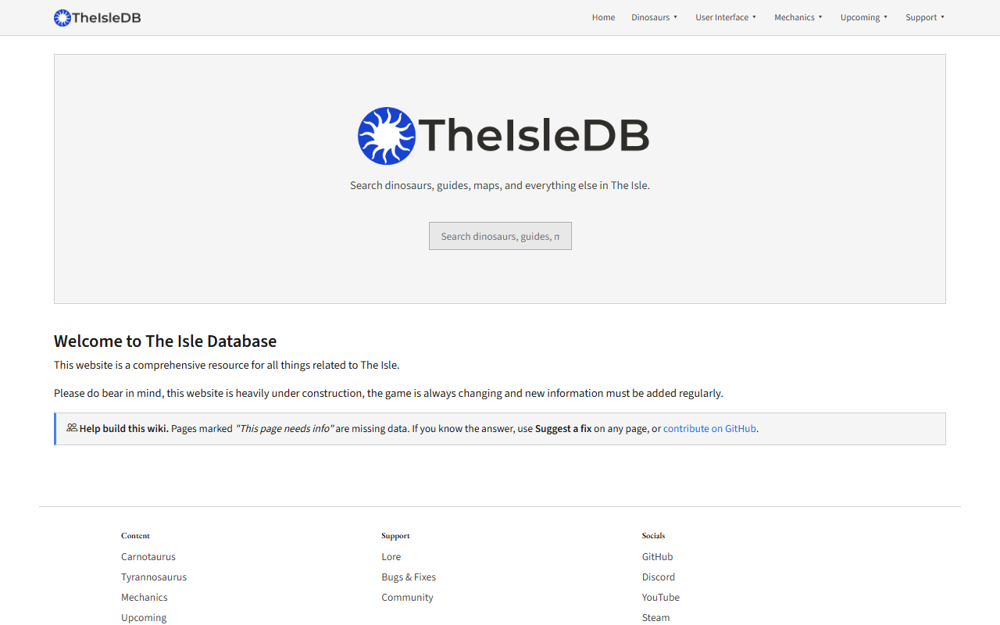

# TheIsleDB

A community wiki for **The Isle: Evrima**: dinosaur stats, calls and skins, plus game mechanics. It is a static site (plain HTML, CSS and JS, with Markdown and TOML content), so there is no build step.

Live site: https://theisledb.netlify.app/



## Help fill it in

Most mechanics pages are still stubs, and several dinosaurs have empty sections. Pages with missing data show a **"This page needs info"** banner.

- **Know something?** Open any page and click **Suggest a fix**. It opens a prefilled GitHub issue, so you don't need to edit any files.
- **Want to edit directly?** Click **Edit this page**. GitHub forks the repo and opens a pull request for you.
- Cite a source for numbers: patch notes, the official roadmap, or an in-game test with the game version.

## Run locally

**VS Code:** open the folder and start it with the Live Server extension (right-click `index.html` → *Open with Live Server*).

**Or with Node.js:**

```bash
node scripts/static-server.mjs
```

Then open http://localhost:5174/. A different port can be passed as an argument.

## Layout

| Path | What it is |
|------|------------|
| `content/<category>/<slug>.md` | Page text. Categories: `dinosaurs`, `mechanics`, `support`, `ui`, `upcoming`. UI pages start with title and date; other pages use plain Markdown. |
| `content/<category>/<slug>.toml` | That page's metadata (`title`, `date`), except UI pages. Dinosaurs keep theirs in `data/dinosaurs/`. |
| `data/dinosaurs/<name>/*.toml` | Per-dinosaur data: attacks, biomes, calls, mutations, nesting, and so on. |
| `data/navbar.json`, `data/footer.json` | Site navigation and footer. |
| `assets/` | Images and dinosaur call audio. See `assets/images/README.md`. |
| `page.html`, `dinosaur.html`, `article.html` | Page templates. They are filled from the `?category=&slug=` or `?dino=` URL. |
| `js/`, `css/` | Rendering code and styles. |
| `admin/` | Optional [Decap CMS](https://decapcms.org/) editor. |
| `scripts/` | Local server and the dinosaur data generator. |

### Adding a page

Create `<slug>.md` and `<slug>.toml` in `content/<category>/` (see `TEMPLATE.md`). Then add the slug to the page lists in `js/search.js` and a link in `data/navbar.json`.

For UI pages, create only a Markdown file under `content/ui/` or its `main-menus/`, `in-game-menus/`, or `hud/` subfolders. Start it with these two lines followed by a blank line and the page text:

```text
title = "User Interface"
date = "2026-05-29"
```

Add the article to its group in `data/navbar.json`; UI search entries come from those links. Nested slugs use paths such as `article.html?category=ui&slug=main-menus/main-menu`.

Pages support extra syntax:

- Key and mouse chips: `{{key|W + LMB}}`
- Floating images: ``

## Dinosaur data generator

`scripts/generate-dinosaur-data.mjs` builds the dinosaur data from a local export of the game files. Set `THE_ISLE_EXPORT_ROOT` to your export folder before running it. It rewrites `content/dinosaurs/*.md` and the data files, so **hand edits to those files are lost when it runs**. Commit or back up first.

## License

GNU GPL v2. See [LICENSE](LICENSE). Game names, art and audio belong to their owners (Afterthought LLC).
